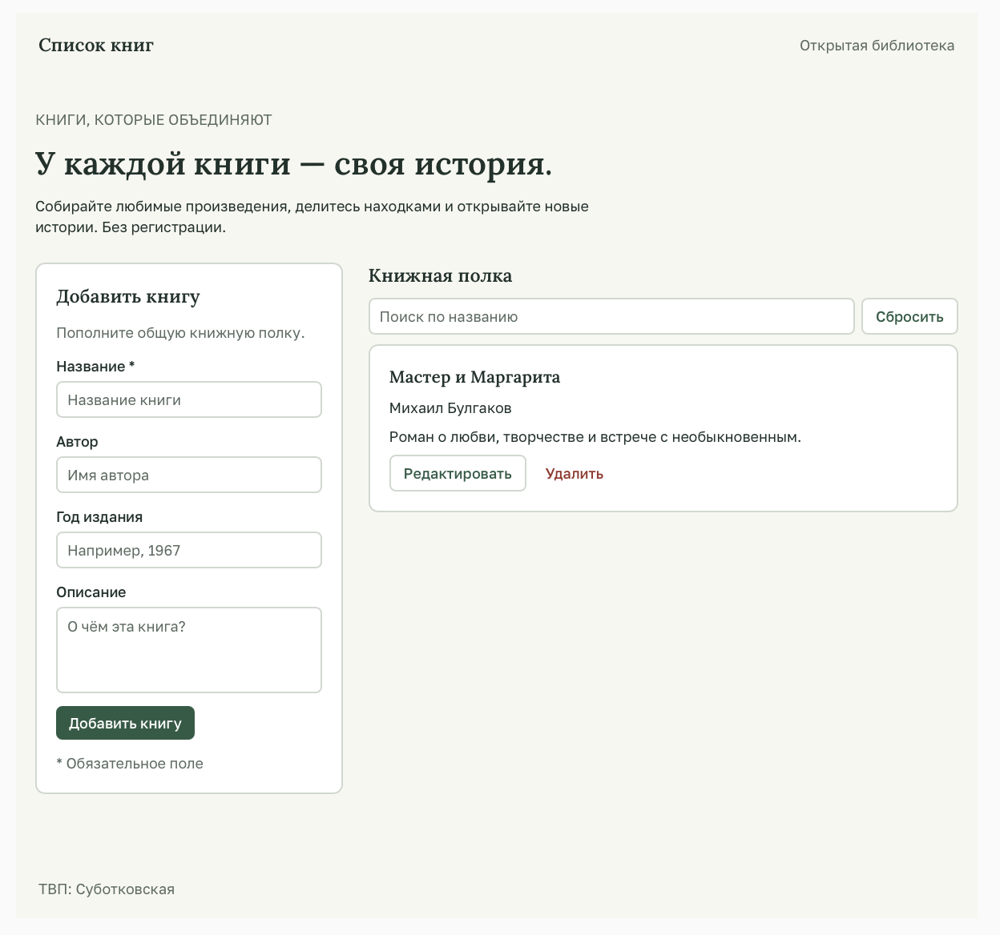

# Отчёт по лабораторной работе №3 — Bubble

## Краткое описание

В ходе лабораторной работы №3 было создано веб-приложение на no-code платформе **Bubble** на тему **«Список книг»**. Приложение публичное (без регистрации) и позволяет пользователям добавлять книги, просматривать их в виде списка, редактировать и удалять.

Каркас приложения сгенерирован с помощью AI-агента Bubble на основе промпта. Затем UI дорабатывался вручную, создавалась сущность в Data и реализовывалась CRUD-логика через Workflows.

**Ссылка на dev-версию:** *(будет добавлена после деплоя)*

---

## Часть 1. Промпт и генерация каркаса

### Промпт (дословно)

```
Создай приложение на тему «Список книг»
Пусть этот сайт будет публичный
Страницу обязательно создай по структуре header + body + footer
Обязательно укажи в заготовке следующую строку: «ТВП: Суботковская»
Добавь несколько интерактивных элементов (реализующих CRUD): форму добавления книги, список книг с возможностью редактирования и удаления, а также поле поиска по названию
```

### Результат генерации

AI-агент создал готовую страницу со следующими элементами:

- **Header** — заголовок «Список книг» и подпись «Открытая библиотека».
- **Body:**
  - Форма «Добавить книгу» с полями: Название, Автор, Год издания, Описание.
  - Кнопка «Добавить книгу».
  - Список «Книжная полка» с поиском и кнопкой «Сбросить».
  - Карточка книги с кнопками «Редактировать» и «Удалить».
- **Footer** — строка «ТВП: Суботковская».



---

## Часть 2. Исследование идеи

*(будет добавлено после изучения Build Guides)*

---

## Часть 3. Ручная доработка UI

*(будет добавлено после ручной доработки)*

---

## Часть 4. Data и Workflows

*(будет добавлено после создания Data Type и CRUD)*

---

## Какие AI-промпты использовались

1. **Часть 1 — генерация каркаса приложения:**

```
Создай приложение на тему «Список книг»
Пусть этот сайт будет публичный
Страницу обязательно создай по структуре header + body + footer
Обязательно укажи в заготовке следующую строку: «ТВП: Суботковская»
Добавь несколько интерактивных элементов (реализующих CRUD): форму добавления книги, список книг с возможностью редактирования и удаления, а также поле поиска по названию
```

---

## Освоенные элементы и workflows

*(будет добавлено по ходу работы)*

---

## Выводы

*(будет добавлено в конце — своими словами)*
