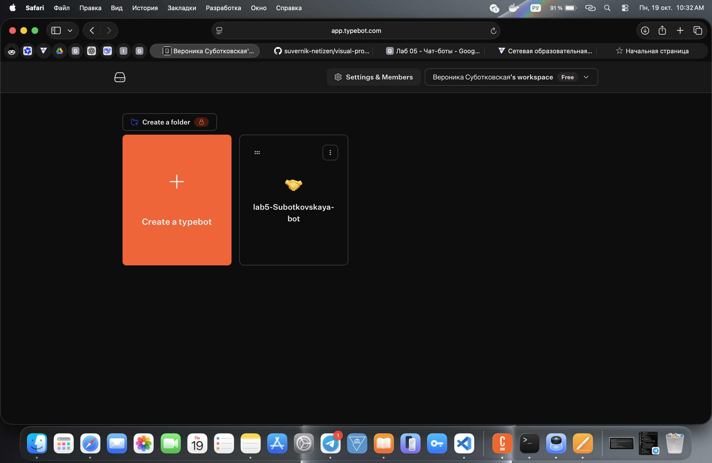
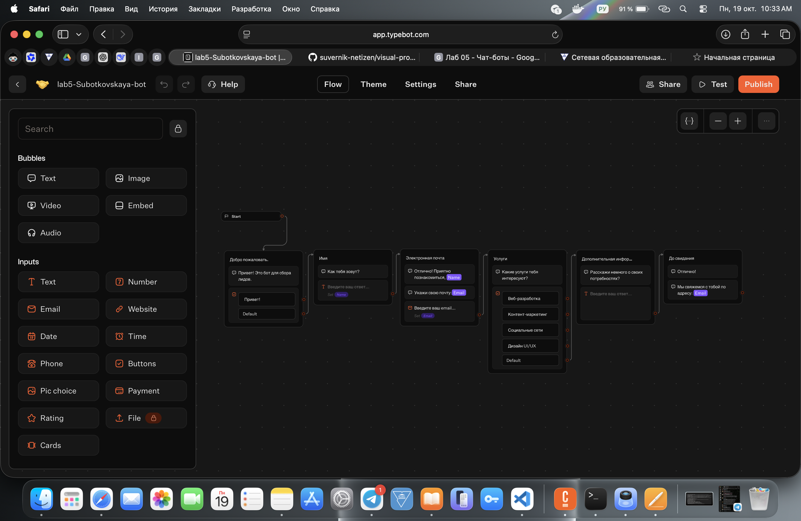
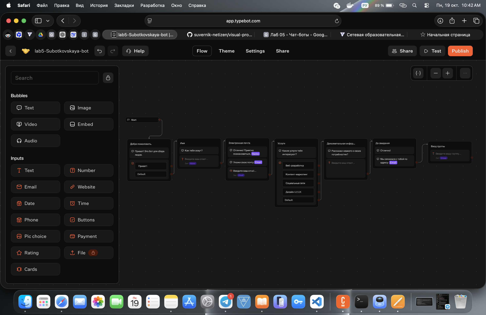
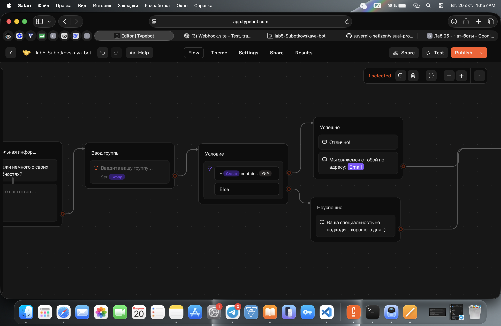
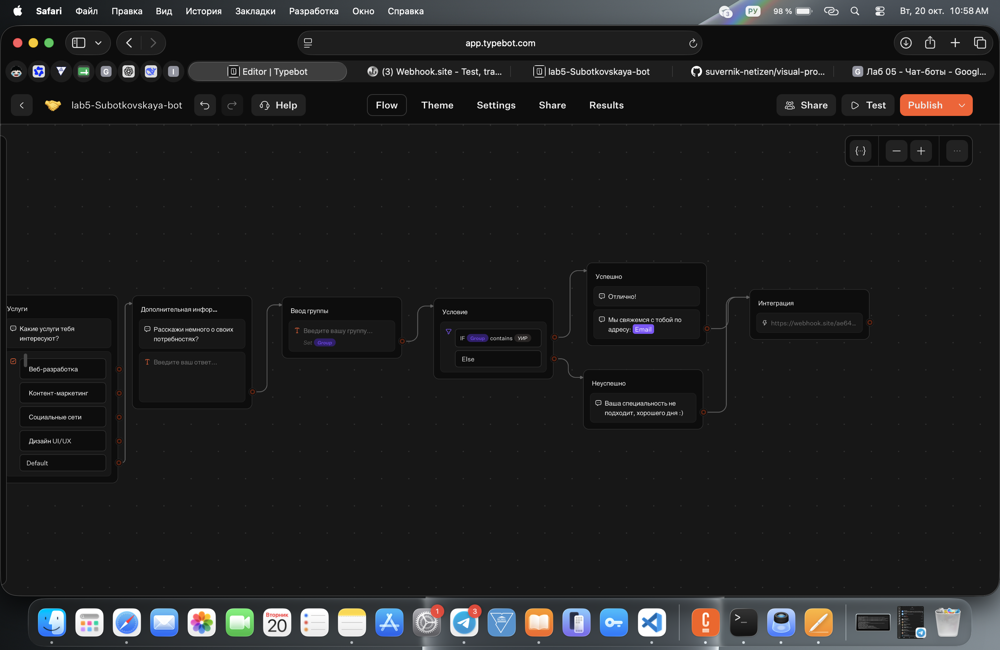
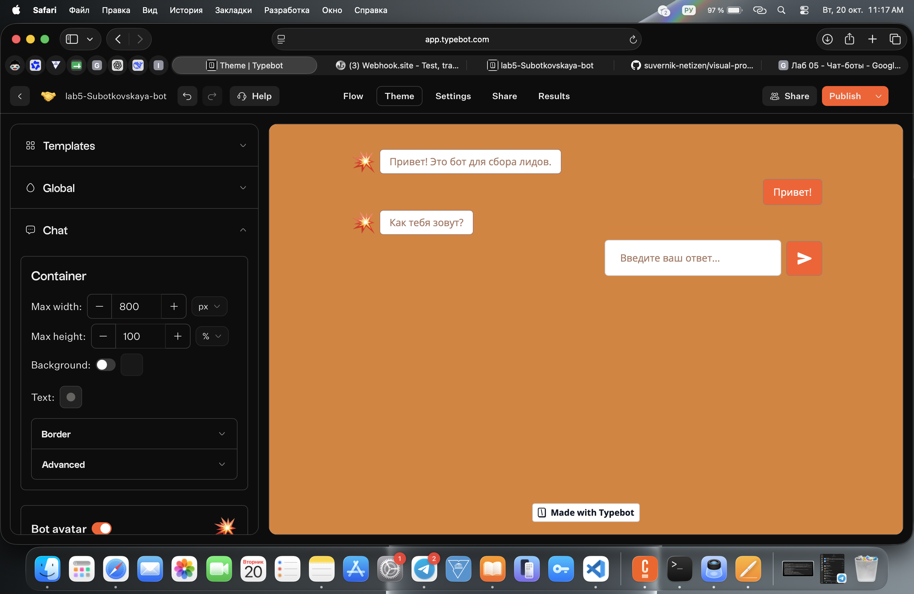
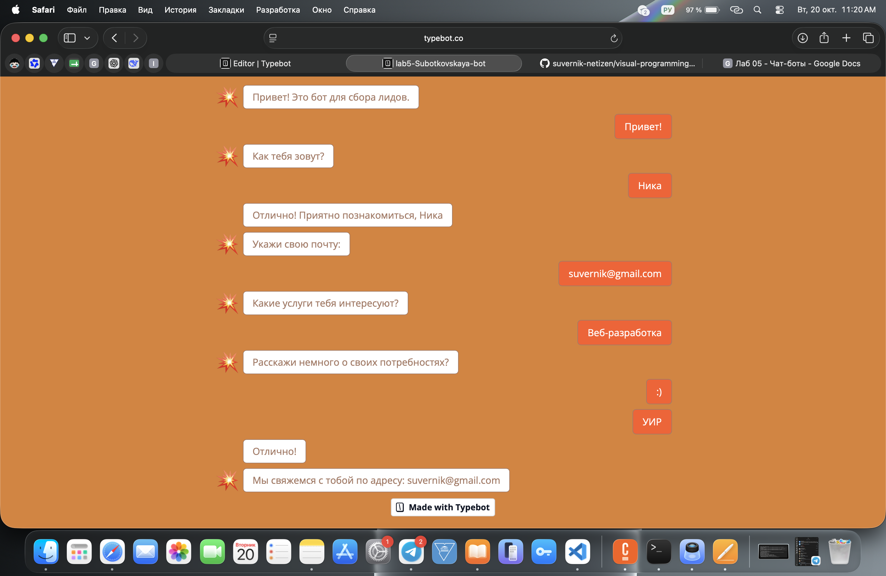

# Лабораторная работа №5. Чат-боты (Трек C. TypeBot)

**Студент:** Субодковская Вероника

## 1. Краткое описание выбранного трека
Выбран трек C (TypeBot). Бот создан на основе готового шаблона «Lead Generation» (Сбор лидов). Проведена полная русификация всех текстов, кнопок и плейсхолдеров. Логика шаблона не нарушена. В сценарий добавлена новая переменная `Group` для сбора информации о группе студента, настроено условие `Condition` для проверки введенной группы, а также добавлена интеграция через `HTTP Request`.

## 2. Ссылка на бота
https://typebot.co/lab5-subotkovskaya-bot-5x8y6k6

## 3. Использованные AI-промпты
В ходе выполнения работы использовались следующие ключевые промпты:
1. *«Как в TypeBot перевести шаблон на русский, не сломав переменные?»* — Ответ: переводить только отображаемый текст в блоках, не трогая имена технических переменных (например, `Name`, `Email`).
2. *«Какой блок в TypeBot использовать для отправки данных на внешний сервис?»* — Ответ: для этих целей используется блок `Webhook` или `HTTP Request` из раздела Integrations.
3. *«Как добавить условие проверки введенной группы в TypeBot?»* — Ответ: нужно перетащить блок `Condition`, выбрать переменную `Group`, оператор `Contains` и указать искомое значение (УИР).
4. *«Как сделать, чтобы бот просто написал текст и закончил диалог без ожидания ответа?»* — Ответ: использовать блок `Text` из раздела Bubbles, а не `Text input` из раздела Inputs.

## 4. Освоенные блоки и элементы
В ходе работы были освоены следующие элементы платформы:
- **Bubbles (Text)**: вывод простых текстовых сообщений.
- **Inputs (Text, Email, Buttons)**: сбор данных от пользователя (имя, почта, выбор услуг).
- **Variables**: создание и использование переменной `Group`.
- **Condition**: настройка логических ветвлений (проверка группы).
- **Integrations (HTTP Request)**: настройка POST-запроса для отправки данных.
- **Theme**: изменение цвета кнопок, фона и аватарки бота.
- **Export**: выгрузка flow в формате JSON.

## 5. Скриншоты всех workflow и диалогов

### 5.1. Workspace и бот

### 5.2. Общая схема Workflow (после изменений)

### 5.3. Настройка переменной Group

### 5.4. Настройка условия Condition

### 5.5. Настройка интеграции HTTP Request

### 5.6. Настройка темы (Theme)

### 5.7. Результат работы бота

## 6. Выводы
В ходе лабораторной работы я освоила платформу TypeBot для создания чат-ботов. Научилась работать с визуальным конструктором: переводить готовые шаблоны, не ломая при этом логику, создавать и использовать переменные для сбора данных, настраивать условия (Condition) для ветвления сценария. Также я научилась настраивать интеграции (HTTP Request) для передачи данных во внешние системы и менять тему оформления. Основная сложность заключалась в понимании того, что изменения в боте не применяются, пока не нажата кнопка Publish. В целом, TypeBot показал себя как мощный и удобный инструмент для быстрого прототипирования чат-ботов.
