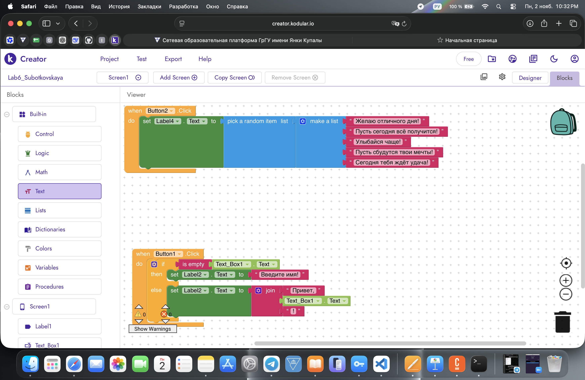
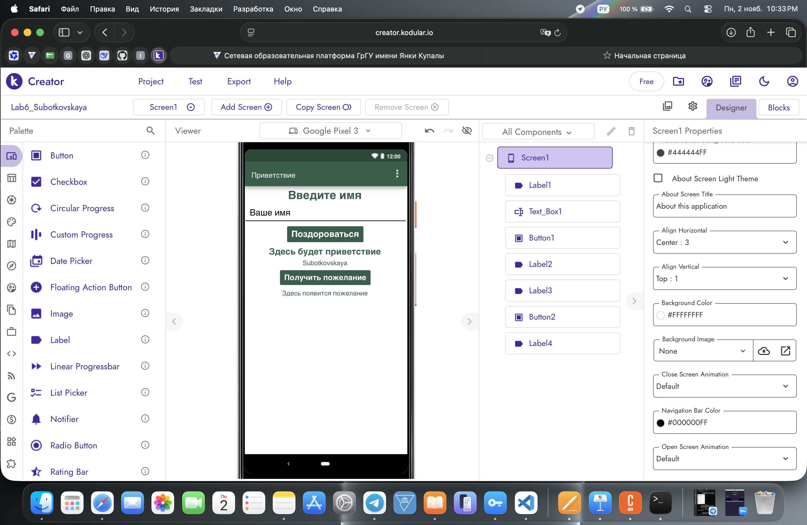

# Лабораторная работа №6 — Kodular

## 1. Описание приложения

В Kodular Creator создано мобильное приложение **«Приветствие»**.

**Название проекта:** `Lab6_Subotkovskaya`

Приложение позволяет пользователю ввести имя и получить персональное приветствие. Если поле ввода пустое, выводится сообщение «Введите имя!».

Дополнительно реализована **ачивка №15 «Своя фича — Генератор случайных пожеланий»**. При нажатии отдельной кнопки приложение случайным образом выбирает одно из пяти пожеланий.

## 2. Интерфейс приложения

На экране Screen1 размещены:

- **Label1** — заголовок «Введите имя».
- **Text_Box1** — поле ввода имени.
- **Button1** — кнопка «Поздороваться».
- **Label2** — вывод приветствия.
- **Label3** — фамилия Subotkovskaya.
- **Button2** — кнопка «Получить пожелание».
- **Label4** — вывод случайного пожелания.

### Скриншот базового интерфейса

## 3. Логика базового приложения

Во вкладке Blocks реализована обработка нажатия кнопки `Button1.Click`.

Используются блоки:

- `if / else` — проверка условия.
- `is empty` — проверка пустого поля.
- `Text_Box1.Text` — получение введённого имени.
- `set Label2.Text to` — вывод сообщения.
- `join` — соединение текста с именем.

**Результат:**

- Пустое поле → «Введите имя!».
- Введено «Вероника» → «Привет, Вероника!».

### Скриншот базовых блоков

## 4. Ачивка №15: Своя фича — Генератор случайных пожеланий

В приложение добавлена функция генерации случайного пожелания.

Для реализации использованы компоненты **Button2** и **Label4**.

При нажатии кнопки «Получить пожелание» выполняется событие `when Button2.Click`. Блок `make a list` содержит пять пожеланий, а `pick a random item` случайным образом выбирает одно из них.

Выбранный текст выводится на экран с помощью блока `set Label4.Text to`.

**Примеры пожеланий:**

- Желаю отличного дня!
- Пусть сегодня всё получится!
- Улыбайся чаще!
- Пусть сбудутся твои мечты!
- Сегодня тебя ждёт удача!

### Скриншот блоков ачивки

### Скриншот интерфейса с ачивкой

## 5. Экспорт проекта

Проект экспортирован из Kodular Creator в формате `.aia`, включая базовую функциональность и генератор случайных пожеланий.

[Скачать исходный проект](../exports/Lab6_Subotkovskaya.aia)

## 6. Использование ИИ

При выполнении лабораторной работы использовался ChatGPT для получения инструкций и объяснения работы визуальных блоков Kodular.

Примеры вопросов к ИИ:

1. Как с помощью `join` сформировать приветствие с именем?
2. Как реализовать генератор случайных пожеланий с помощью `make a list` и `pick a random item`?

Настройка интерфейса, создание блоков и экспорт проекта выполнялись вручную.

## 7. Ограничения и проверка

Работа выполнена с использованием бесплатного тарифа Kodular.

Согласно условиям лабораторной работы, ограничения бесплатного тарифа составляют до 10 проектов, 10 МБ ассетов и 5 расширений.

Структура визуальных блоков проверена в редакторе Kodular. Тестирование приложения на Android-устройстве не проводилось.

## 8. Вывод

В ходе лабораторной работы я освоила создание интерфейса мобильного приложения в Kodular, настройку компонентов и работу с визуальными блоками.

Было разработано приложение «Приветствие» с проверкой введённого имени. Дополнительно реализована собственная функция генерации случайных пожеланий с использованием списка и случайного выбора элемента.

Проект экспортирован в формате `.aia`, а материалы лабораторной работы подготовлены для размещения в GitHub.
