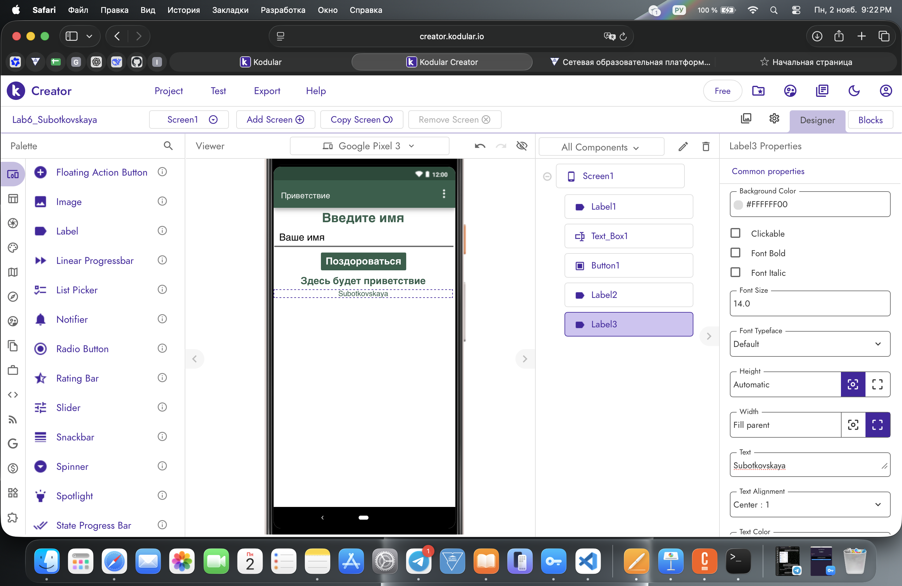
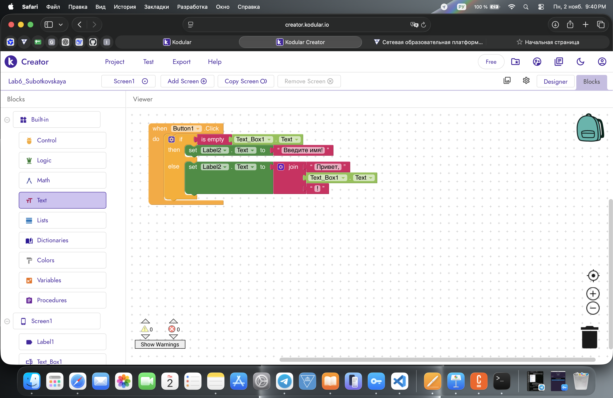

# Лабораторная работа №6 — Kodular

## 1. Описание приложения

В Kodular Creator создано мобильное приложение **«Приветствие»**.

**Название проекта:** `Lab6_Subotkovskaya`

Приложение позволяет ввести имя и получить персональное приветствие. Если поле пустое, выводится сообщение «Введите имя!».

## 2. Интерфейс приложения

На экране Screen1 размещены:

- **Label1** — заголовок «Введите имя».
- **Text_Box1** — поле ввода имени.
- **Button1** — кнопка «Поздороваться».
- **Label2** — вывод результата.
- **Label3** — фамилия Subotkovskaya.

### Скриншот интерфейса

## 3. Логика приложения

Во вкладке Blocks реализована обработка нажатия кнопки `Button1.Click`.

Используются следующие блоки:

- `if / else` — проверка условия.
- `is empty` — проверка пустого поля.
- `Text_Box1.Text` — получение введённого имени.
- `set Label2.Text to` — вывод сообщения.
- `join` — соединение текста с именем.

**Результат работы:**

- Пустое поле → «Введите имя!».
- Введено «Вероника» → «Привет, Вероника!».

### Скриншот блоков

## 4. Экспорт проекта

Проект экспортирован в формате `.aia`.

[Скачать исходный проект](../exports/Lab6_Subotkovskaya.aia)

## 6. Вывод

В ходе лабораторной работы я освоила создание интерфейса мобильного приложения в Kodular, настройку компонентов и работу с визуальными блоками `if / else` и `join`.

Было разработано приложение «Приветствие», реализована логика обработки введённого имени и выполнен экспорт проекта в формате `.aia`.
