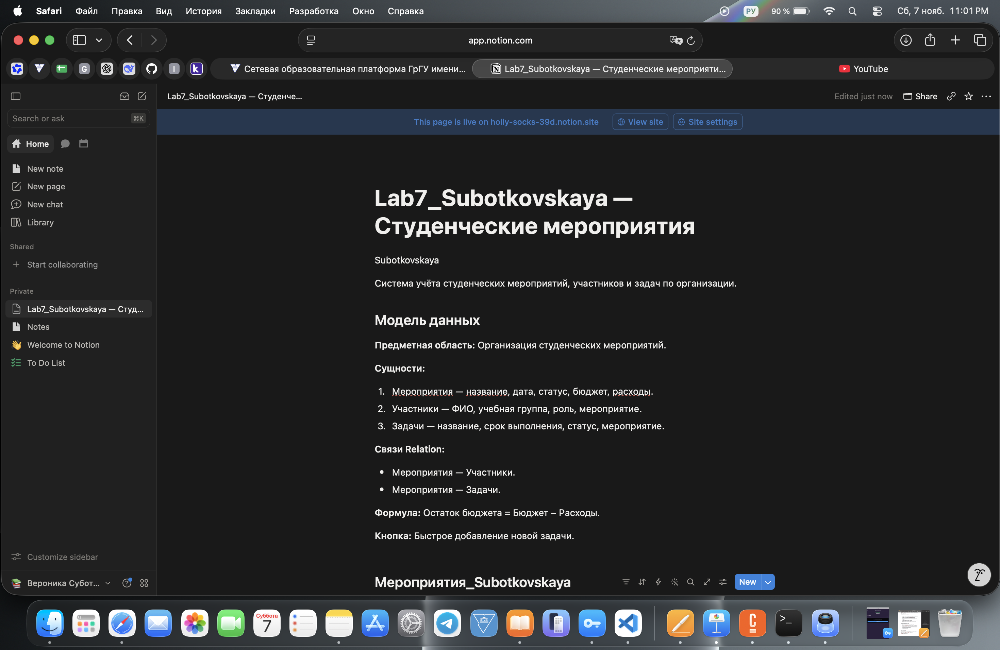
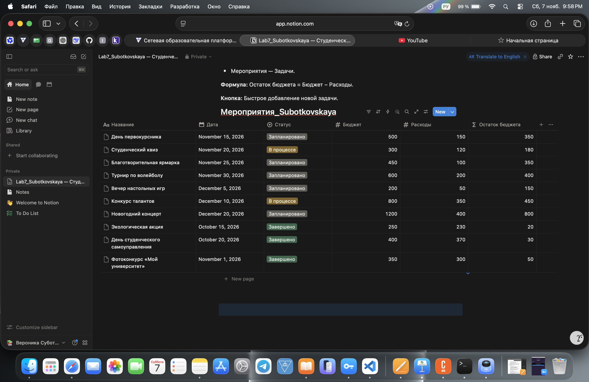
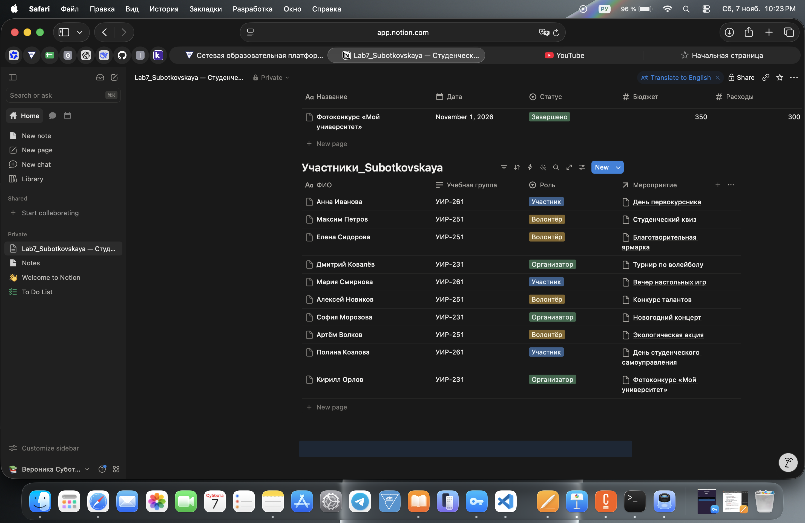
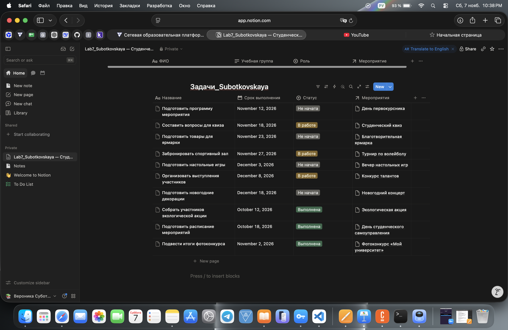
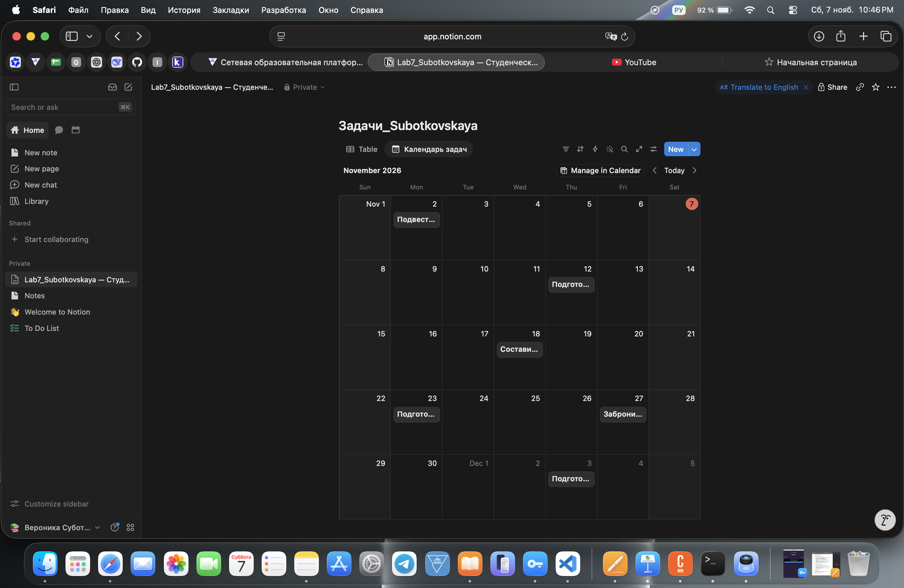
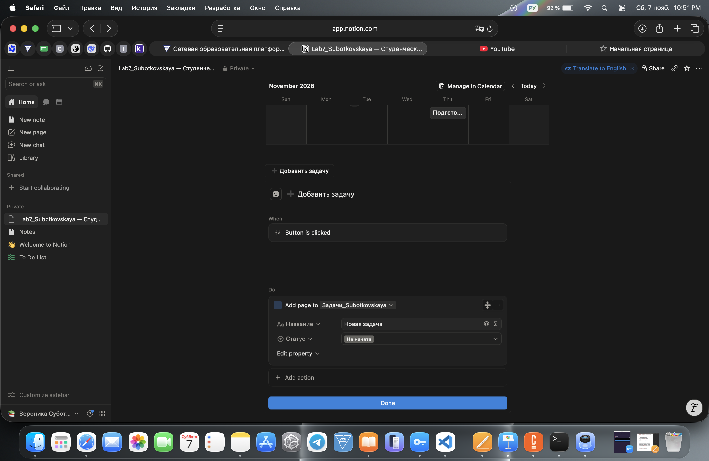

# Лабораторная работа №7 — Notion

## 1. Описание проекта

В Notion создано рабочее пространство **«Lab7_Subotkovskaya — Студенческие мероприятия»**.

**Предметная область:** организация студенческих мероприятий.

Проект предназначен для хранения информации о мероприятиях, участниках и задачах по их подготовке.

На главной странице размещена фамилия **Subotkovskaya** на английском языке.

**Ссылка на опубликованный проект:**

https://holly-socks-39d.notion.site/Lab7_Subotkovskaya-411ae28c8a7b800da272c7f344b55305

### Скриншот главной страницы

## 2. Генерация модели данных с помощью ИИ

Для разработки модели данных использовался ChatGPT.

**Промпт:**

«Придумай простую и уникальную предметную область для учебного проекта в Notion. Нужно создать 3 связанные базы данных, минимум 2 связи Relation, свойства типов Title, Select, Date, Number, Formula и одну кнопку Button. Опиши модель данных и объясни связи».

**Предложенная ИИ предметная область:** организация студенческих мероприятий.

### Сгенерированная модель

**База 1. Мероприятия**
- Название — Title.
- Дата — Date.
- Статус — Select.
- Бюджет — Number.
- Расходы — Number.
- Остаток бюджета — Formula.

**База 2. Участники**
- ФИО — Title.
- Учебная группа — Text.
- Роль — Select.
- Мероприятие — Relation.

**База 3. Задачи**
- Название — Title.
- Срок выполнения — Date.
- Статус — Select.
- Мероприятие — Relation.

**Связи:**
1. Мероприятия ↔ Участники.
2. Мероприятия ↔ Задачи.

### Проверка и уточнение модели

После проверки модели были уточнены следующие моменты:

- Для связи участников и задач с мероприятиями выбран тип Relation вместо обычного текстового поля.
- Для обеих связей включено двустороннее отображение.
- Для расчёта остатка бюджета добавлено вычисляемое свойство Formula.
- Для статусов мероприятий и задач настроены отдельные значения Select.
- Для быстрого добавления задач предусмотрена кнопка Button.

Модель включает 3 сущности и 2 связи Relation, что соответствует требованиям задания.

## 3. Реализация баз данных

### 3.1. База «Мероприятия_Subotkovskaya»

Создана база из 10 мероприятий.

Для каждого мероприятия указаны название, дата, статус, бюджет и расходы.

Настроена формула расчёта остатка бюджета:

`prop("Бюджет") - prop("Расходы")`

Формула автоматически вычисляет разницу между бюджетом и расходами.

### 3.2. База «Участники_Subotkovskaya»

Создана база из 10 участников.

Для каждого участника указаны ФИО, учебная группа, роль и связанное мероприятие.

Связь Relation позволяет выбирать мероприятие из существующих записей базы «Мероприятия».

### 3.3. База «Задачи_Subotkovskaya»

Создана база из 10 задач по организации мероприятий.

Для каждой задачи указаны название, срок выполнения, статус и связанное мероприятие.

Используется вторая связь Relation с базой «Мероприятия».

## 4. Представления базы данных

Для базы «Задачи_Subotkovskaya» настроены два представления:

- **Table** — отображение задач в виде таблицы.
- **Календарь задач (Calendar)** — отображение задач по датам выполнения.

Для календаря выбрано свойство «Срок выполнения».

## 5. Кнопка Button

На главной странице добавлена кнопка **«➕ Добавить задачу»**.

При нажатии выполняется действие `Add page to`, которое создаёт новую запись в базе «Задачи_Subotkovskaya».

Для новой записи автоматически устанавливаются:

- Название — «Новая задача».
- Статус — «Не начата».

## 6. Использование искусственного интеллекта

При выполнении лабораторной работы использовался ChatGPT для проектирования модели данных и получения инструкций по работе с Notion.

Основные AI-запросы:

1. Какую простую предметную область выбрать для лабораторной работы в Notion?
2. Как создать три связанные базы данных с минимум двумя связями Relation?
3. Как настроить формулу расчёта остатка бюджета?
4. Как создать календарное представление базы данных?
5. Как сделать кнопку для автоматического добавления новой задачи?

Создание баз, заполнение записей и настройка свойств выполнялись вручную.

## 7. Освоенные возможности Notion

В ходе выполнения лабораторной работы освоены:

- Создание страниц и баз данных.
- Свойства Title, Text, Select, Date, Number.
- Связи Relation между базами данных.
- Вычисляемые свойства Formula.
- Представления Table и Calendar.
- Создание кнопок Button.
- Публикация страницы через Publish to web.
- Организация данных и управление записями.

Работа выполнялась с использованием бесплатного тарифа Notion. Дополнительные платные возможности не использовались.

## 8. Дополнительные возможности

Дополнительные ачивки не выполнялись. Реализована обязательная часть лабораторной работы.

## 9. Вывод

В ходе лабораторной работы я познакомилась с платформой Notion и научилась создавать связанные базы данных.

Было разработано рабочее пространство для организации студенческих мероприятий с тремя базами данных, двумя связями Relation, формулой расчёта бюджета и календарным представлением задач.

Также я научилась создавать кнопки для добавления записей и публиковать страницы Notion в интернете.

В результате получилась система для хранения информации о мероприятиях, участниках и задачах по их организации.
