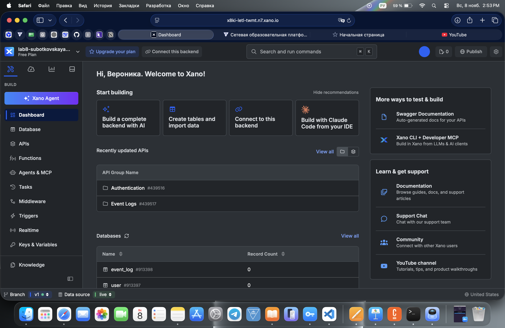
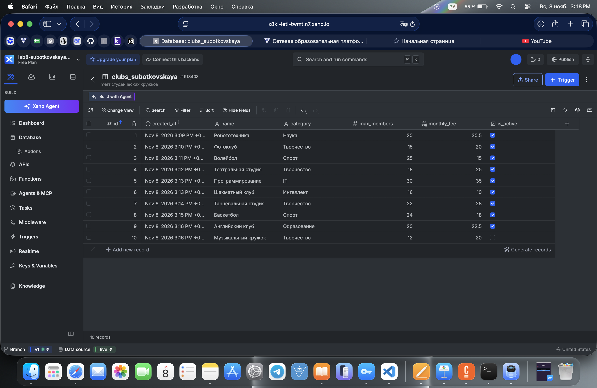
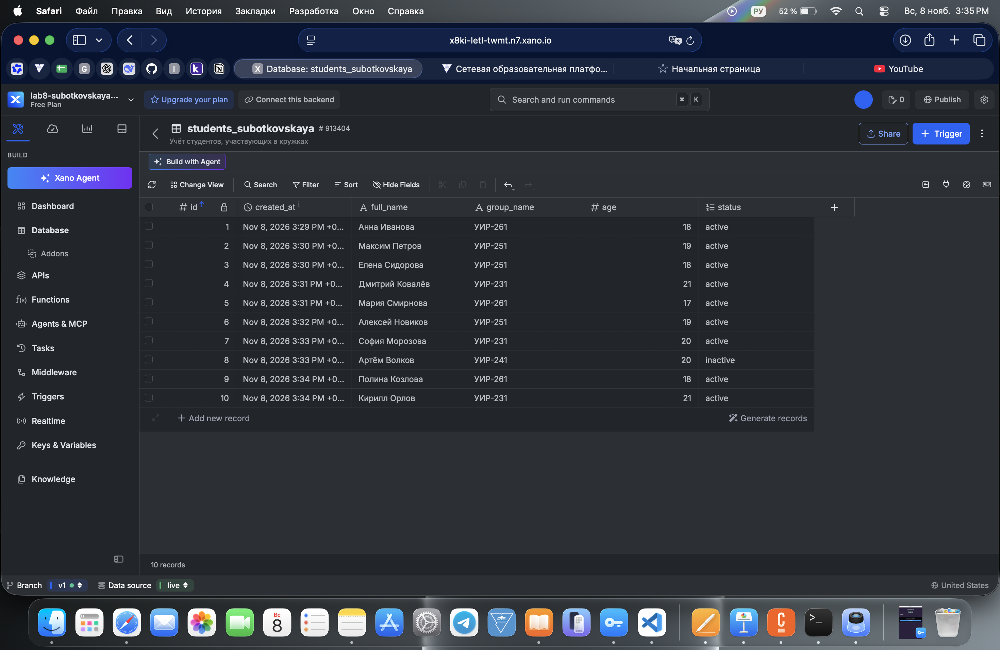
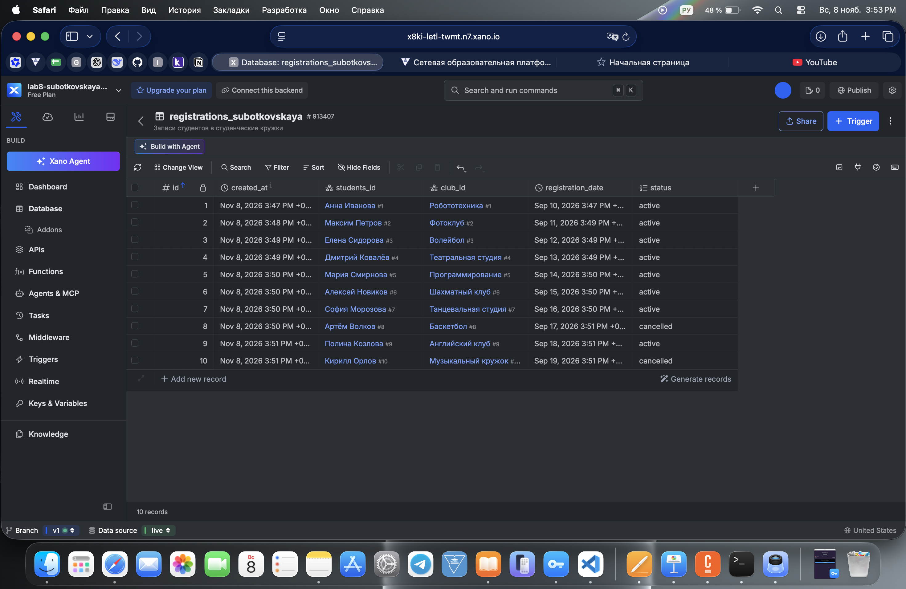
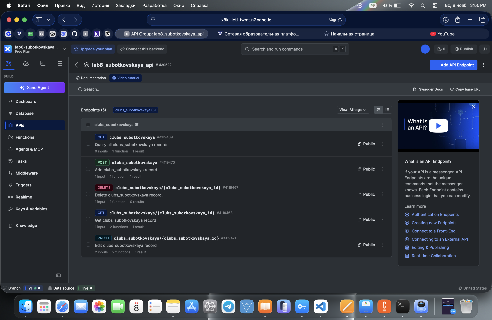
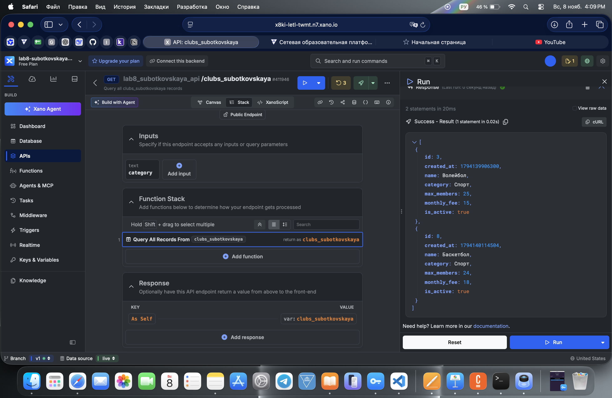
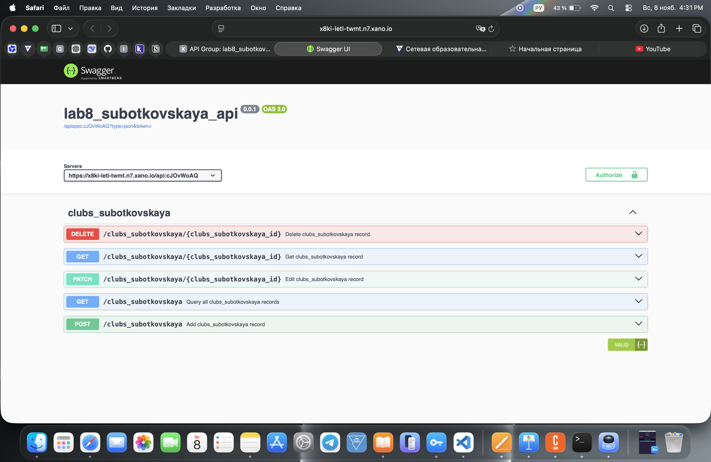
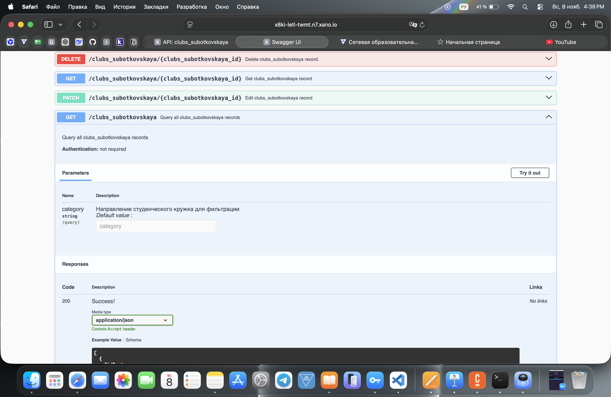
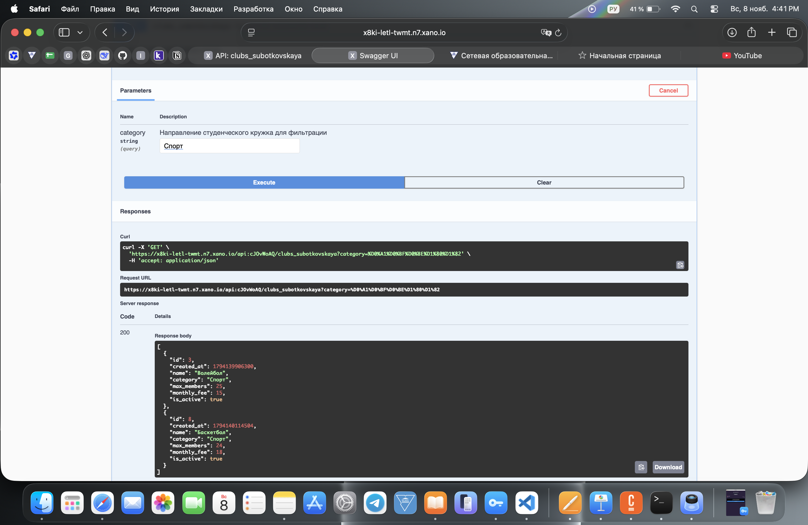

# Лабораторная работа №8 — Xano

## 1. Описание проекта

В Xano создан бэкенд для системы **«Учёт студенческих кружков»**.

**Название Workspace:** `lab8-subotkovskaya-api`

Проект предназначен для хранения информации о студенческих кружках, студентах и их регистрациях на занятия.

Работа выполнена на бесплатном тарифе Xano.

## 2. Генерация модели данных с помощью ИИ

Для проектирования базы данных и API использовался ChatGPT.

**Промпт:**

«Предложи простую предметную область для лабораторной работы в Xano. Нужно создать 3 связанные таблицы, минимум 2 связи Reference, использовать типы полей Text, Integer, Decimal, Boolean, Timestamp, Enum и реализовать REST API с CRUD-операциями».

**Предложенная ИИ предметная область:** учёт студенческих кружков.

### 2.1. Сгенерированная модель данных

**Таблица 1. `clubs_subotkovskaya` — кружки**

| Поле | Тип | Назначение |
|---|---|---|
| id | Integer | Идентификатор кружка |
| created_at | Timestamp | Дата создания записи |
| name | Text | Название кружка |
| category | Text | Направление кружка |
| max_members | Integer | Максимальное количество участников |
| monthly_fee | Decimal | Стоимость занятий |
| is_active | Boolean | Активность кружка |

**Таблица 2. `students_subotkovskaya` — студенты**

| Поле | Тип | Назначение |
|---|---|---|
| id | Integer | Идентификатор студента |
| created_at | Timestamp | Дата создания записи |
| full_name | Text | ФИО студента |
| group_name | Text | Учебная группа |
| age | Integer | Возраст |
| status | Enum | Статус студента |

Значения Enum: `active`, `inactive`.

**Таблица 3. `registrations_subotkovskaya` — регистрации**

| Поле | Тип | Назначение |
|---|---|---|
| id | Integer | Идентификатор регистрации |
| created_at | Timestamp | Дата создания записи |
| students_id | Reference | Связь со студентом |
| club_id | Reference | Связь с кружком |
| registration_date | Timestamp | Дата регистрации |
| status | Enum | Статус регистрации |

Значения Enum: `active`, `cancelled`.

### 2.2. Связи между таблицами

Настроены две связи Reference:

1. `registrations_subotkovskaya.students_id` → `students_subotkovskaya.id`
2. `registrations_subotkovskaya.club_id` → `clubs_subotkovskaya.id`

Они позволяют определить, какой студент записан в конкретный кружок.

### 2.3. Проверка и уточнение модели

После проверки предложенной модели были внесены следующие уточнения:

- В названия таблиц добавлена фамилия `Subotkovskaya`.
- Для статусов использован тип Enum с ограниченным набором значений.
- Возраст студентов приведён в соответствие с учебными группами.
- Для связей между таблицами использованы поля Reference.
- Добавлено отдельное поле `registration_date`.
- Для GET-запроса предусмотрена фильтрация по направлению кружка.

## 3. Реализация базы данных

В Xano созданы три таблицы, каждая из которых содержит по 10 записей.

### 3.1. Таблица кружков

В таблицу `clubs_subotkovskaya` добавлены 10 кружков разных направлений.

Для каждого указаны название, категория, максимальное количество участников, стоимость занятий и признак активности.

### 3.2. Таблица студентов

В таблицу `students_subotkovskaya` добавлены 10 студентов.

Для каждого указаны ФИО, учебная группа, возраст и статус.

### 3.3. Таблица регистраций

В таблицу `registrations_subotkovskaya` добавлены 10 записей студентов в кружки.

Настроены две связи Reference с таблицами студентов и кружков. Также указаны даты и статусы регистраций.

**Итого:** 3 таблицы, 30 записей и 2 связи Reference.

## 4. Создание REST API

Для таблицы `clubs_subotkovskaya` автоматически созданы пять CRUD-эндпоинтов.

| Метод | Эндпоинт | Назначение |
|---|---|---|
| GET | `/clubs_subotkovskaya` | Получение списка кружков |
| GET | `/clubs_subotkovskaya/{clubs_subotkovskaya_id}` | Получение кружка по ID |
| POST | `/clubs_subotkovskaya` | Создание кружка |
| PATCH | `/clubs_subotkovskaya/{clubs_subotkovskaya_id}` | Изменение кружка |
| DELETE | `/clubs_subotkovskaya/{clubs_subotkovskaya_id}` | Удаление кружка |

Все эндпоинты находятся в API-группе `lab8_subotkovskaya_api`.

### 4.1. Path-параметр

В GET, PATCH и DELETE используется параметр `clubs_subotkovskaya_id`.

Пример запроса:

`GET /clubs_subotkovskaya/1`

В результате возвращается информация о кружке «Робототехника».

### 4.2. Query-параметр

В GET-запрос добавлен необязательный параметр `category` типа Text для фильтрации кружков по направлению.

Пример:

`GET /clubs_subotkovskaya?category=Спорт`

В `Query All Records` настроено условие сравнения входного параметра с полем `category` таблицы кружков.

Включена настройка `Ignore empty values`.

**Результат проверки:**

- Без параметра — 10 кружков.
- С `category=Спорт` — 2 кружка: «Волейбол» и «Баскетбол».

## 5. Проверка CRUD-эндпоинтов

Все пять эндпоинтов протестированы через встроенную функцию Run в Xano.

| Метод | Выполненное действие | Результат |
|---|---|---|
| GET | Получение всех кружков | Получено 10 записей |
| GET по ID | Получение кружка с ID 1 | Получена «Робототехника» |
| POST | Создание «Клуба дизайна» | Создана запись с ID 11 |
| PATCH | Изменение названия и стоимости | Изменения сохранены |
| DELETE | Удаление записи с ID 11 | Запись удалена |

Через POST был создан тестовый кружок «Клуб дизайна».

С помощью PATCH его название изменено на «Клуб графического дизайна», а стоимость — с 20.5 до 25.

После проверки запись удалена через DELETE. В базе снова осталось 10 кружков.

## 6. Swagger и документация API

Для созданной API-группы доступна документация Swagger на основе OpenAPI 3.0.

**Ссылка на Swagger:**

https://x8ki-letl-twmt.n7.xano.io/api:cJOvWoAQ#/clubs_subotkovskaya/lab8_subotkovskaya_api%2Fclubs_subotkovskaya%7CGET

Swagger содержит описание всех пяти CRUD-эндпоинтов.

После публикации изменений GET-эндпоинта в Swagger появился query-параметр `category`.

Через Swagger выполнен запрос с параметром `category=Спорт`.

**Результат:** HTTP-код `200` и JSON-ответ с двумя кружками: «Волейбол» и «Баскетбол».

## 7. Использование искусственного интеллекта

При выполнении лабораторной работы использовался ChatGPT для проектирования модели данных, подготовки тестовых записей и настройки API.

Примеры AI-запросов:

1. Какую простую предметную область выбрать для лабораторной работы в Xano?
2. Какие поля и типы данных нужны для трёх связанных таблиц?
3. Как заполнить таблицы кружков, студентов и регистраций десятью записями?
4. Как настроить query-параметр `category` в GET-эндпоинте?
5. Как проверить работу CRUD-запросов и документацию Swagger?

Создание таблиц, настройка связей, выполнение запросов и тестирование проводились вручную.

## 8. Освоенные возможности Xano

В ходе лабораторной работы освоены:

- Создание Workspace и таблиц Database.
- Работа с типами Text, Integer, Decimal, Boolean, Timestamp и Enum.
- Создание связей Reference.
- Заполнение таблиц данными.
- Создание REST API и CRUD-операций.
- Работа с path- и query-параметрами.
- Фильтрация записей через Query All Records.
- Проверка запросов с помощью Run.
- Публикация изменений API.
- Работа со Swagger и JSON-ответами.

Проект выполнен на бесплатном тарифе Xano. Платные функции не использовались.

## 9. Дополнительные возможности

Дополнительные ачивки не выполнялись. Реализована обязательная базовая часть лабораторной работы.

## 10. Вывод

В ходе лабораторной работы я освоила основы создания серверной части приложения с помощью платформы Xano.

Были созданы три связанные таблицы для учёта студенческих кружков, студентов и регистраций, настроены два поля Reference и разработаны пять CRUD-эндпоинтов.

Я научилась передавать параметры в API-запросах, фильтровать данные и проверять работу эндпоинтов через Xano и Swagger.

В результате получилась работающая серверная часть учебной системы учёта студенческих кружков.
